<p align="center">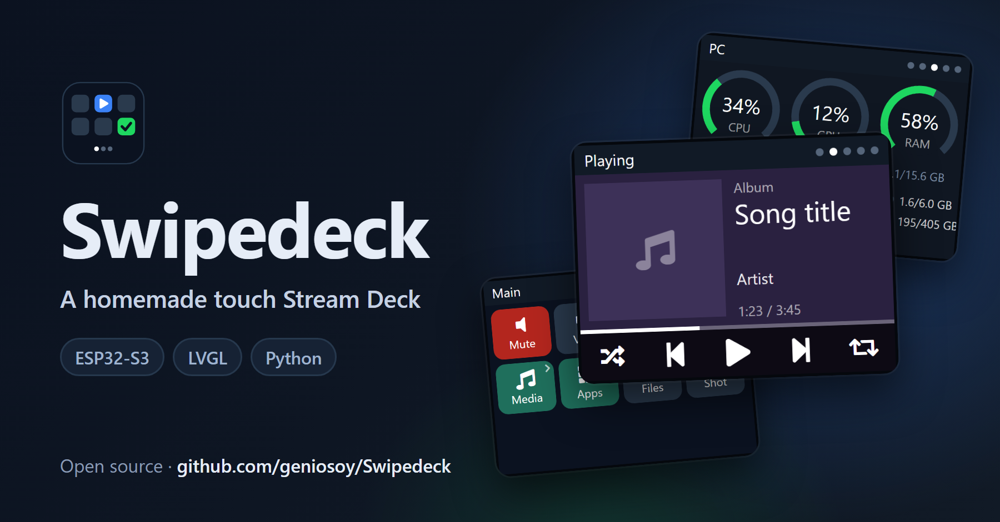</p>

# Swipedeck (Streamdeck for the ES3C28P)

A (vibecoded) touch macro deck with a "Now playing" screen and a PC stats screen, for the Hosyond/LCDWiki 2.8" ESP32-S3 board (ES3C28P).

<table align="center">
  <tr>
    <td align="center">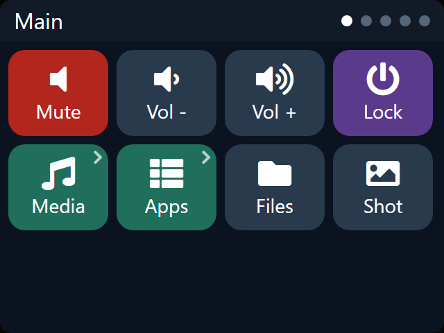<br><sub>Keys</sub></td>
    <td align="center">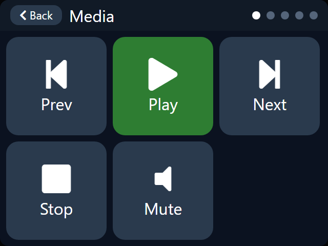<br><sub>Folders, with Back</sub></td>
    <td align="center">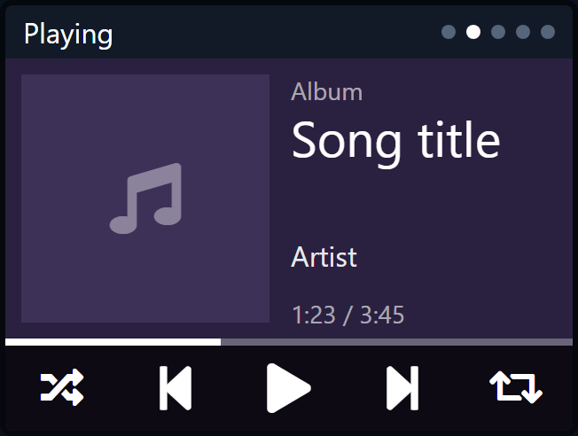<br><sub>Now playing</sub></td>
    <td align="center">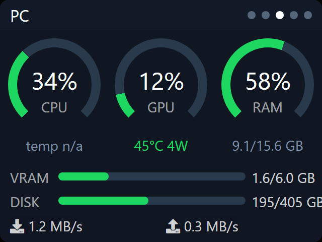<br><sub>PC stats</sub></td>
  </tr>
</table>
<p align="center"><sub>Swipe left and right to move between desktops,
tap a folder key to open a page.</sub></p>

<table align="center">
  <tr>
    <td align="center">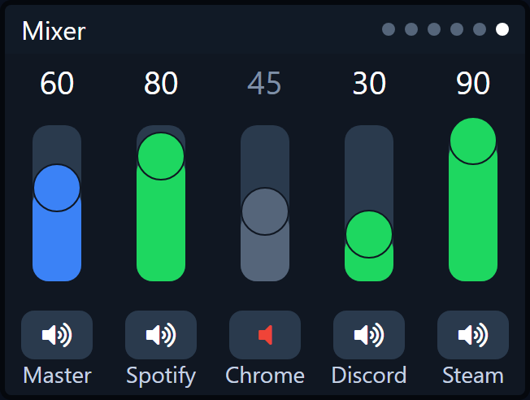<br><sub>Volume mixer</sub></td>
    <td align="center">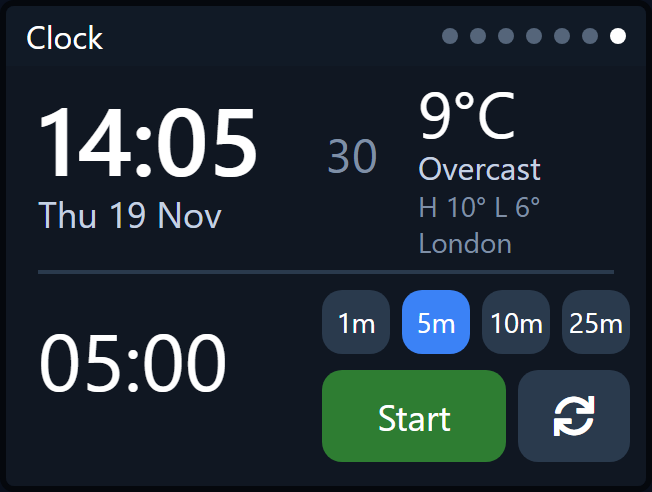<br><sub>Clock, weather and timer</sub></td>
  </tr>
</table>

## How it fits together

<p align="center">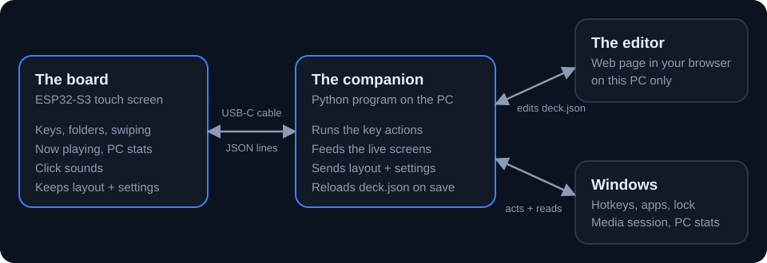</p>

The board holds the screens, the touch handling, the sounds and a copy of the layout. Everything that needs the PC (key
actions, the media session, PC stats, volumes) happens in the companion, which also serves the editor. Nothing leaves
your PC by itself: the editor only listens on `127.0.0.1`. What does go out is what you set up: HTTP actions, and the
weather on the clock screen (only the place's coordinates, see [below](#volume-mixer-and-clock-screens)).
Firmware: Arduino + PlatformIO + LVGL 8.3.6 (v0.13.0).

## The layout editor

Layouts are edited in a web page, not by hand: drag keys, pick icons and colours, add ready-made desktops and button
presets, and see the board's screen as you type.

<p align="center">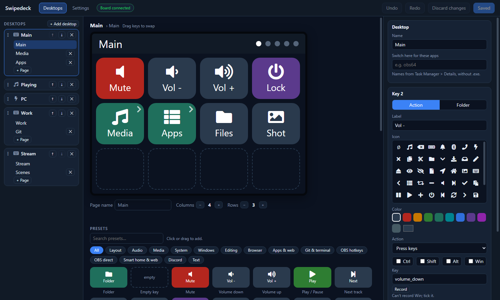</p>

<table align="center">
  <tr>
    <td align="center">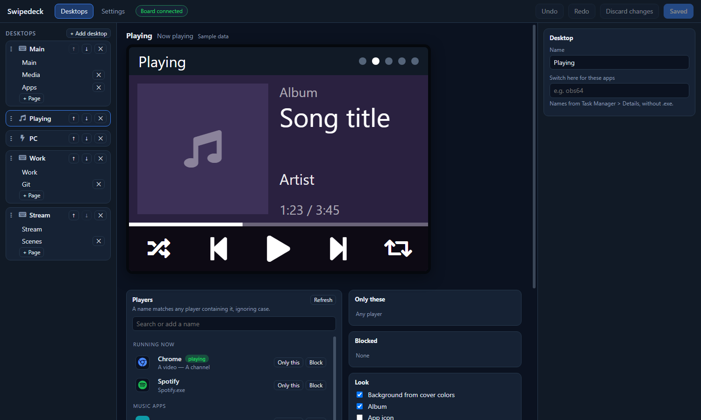<br><sub>Now playing: choose which players are shown and how it looks</sub></td>
    <td align="center">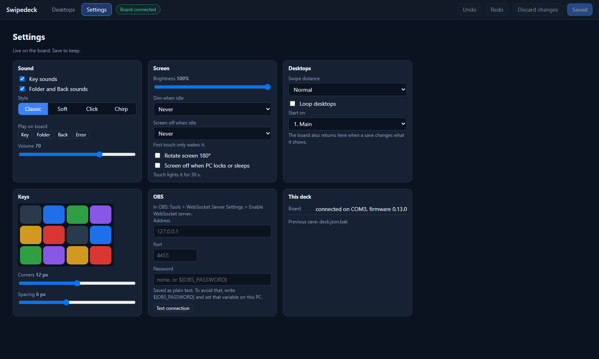<br><sub>Settings: sounds, dimming, swipe, key look</sub></td>
  </tr>
</table>

## What it does

* **Desktops** you swipe between. A *keys* desktop holds **pages** of keys; a folder key opens a page, a back button
  returns. A fixed top bar shows the title, the back button and dots for the current desktop.
* **Key actions** on the PC: hotkeys (also media/volume keys), typed text, open file/URL/app, run a program, lock the PC,
  and sequences of these.
* **Now playing** desktop (Spotify Car Thing style) fed by the Windows media session (the volume-popup one): cover,
  cover-tinted background, album / title / artist, elapsed / total time, a thin progress bar you can drag to seek, and
  shuffle / previous / play-pause / next / repeat.
* **PC stats** desktop: CPU, GPU and RAM gauges, GPU temperature and power, VRAM and disk bars, network speed.
* **Sound feedback** on touch (ES8311 codec + speaker): tick on a key, chirp when opening a folder, falling chirp on Back,
  in one of four sound themes.
* **Settings** you can try live: sounds, brightness, auto-dim and screen-off, flipping the screen, endless scrolling
  between desktops, swipe length, and how the keys look (see [Settings](#settings)).
* **Keys that do more:** a second action when a key is held, volume-style keys that repeat while held, and keys that
  change their look with the PC (red while the speakers are muted, green while a program runs), see
  [Hold, state and active-app features](#hold-state-and-active-app-features).
* **A desktop per app:** the desktop of the program in front (OBS, VS Code ...) comes to the front by itself.
* **Sleeps with the PC:** the screen can go off while the PC is locked, asleep or off.
* **Volume mixer** desktop: drag the master volume and the volume of up to four programs, and mute each one.
* **Clock** desktop: the time, the weather and a countdown timer that rings on the board (see
  [Volume mixer and clock screens](#volume-mixer-and-clock-screens)).
* **Web and OBS actions:** a key can send an HTTP request (a webhook, Home Assistant ...) or control OBS (scenes,
  recording, streaming, mute), see [HTTP, OBS and Discord actions](#http-obs-and-discord-actions).
* The board stores the last layout and the settings, so it still works without the PC (key presses just do nothing).

## Running it

**PC side:** double-click **`Streamdeck.bat`**. On the first run it creates the Python environment
(`companion\.venv`) and installs the requirements, then starts the companion; afterwards it just starts. Arguments are
passed through: `--dry-run` (log actions, do not run them), `--no-media`, `--no-stats`, `--no-watch` (do not look at the
active app, mute state or screen lock), `--no-mixer`, `--no-weather` (never fetch the weather or search for places),
`--port COM3`, `--deck FILE`,
`--check` (validate the deck file and exit), `-v` (debug log).

* **`Streamdeck-background.vbs`** starts it without a window (log: `companion\companion.log`). A shortcut to it in the
  Startup folder (Win+R, `shell:startup`) starts the companion with Windows.
* **`Streamdeck-Editor.bat`** opens the deck editor in your browser (starting the companion in the background first if
  it is not running). The editor lives at http://127.0.0.1:8765/ whenever the companion runs.
* **`Stop-Streamdeck.bat`** stops a running companion (hidden or not). Do this before flashing: it holds the USB port.
  It reconnects by itself after a replug or reflash.

**Board:** the firmware is flashed with PlatformIO:

```
%USERPROFILE%\.platformio\penv\Scripts\pio.exe run -t upload --upload-port COM3
```

If the board does not accept the upload: hold BOOT, tap RESET, release BOOT, upload, tap RESET once.

## The deck editor (web)

The companion serves a layout editor at **http://127.0.0.1:8765/** (`Streamdeck-Editor.bat` opens it). Saving writes
`companion/deck.json`, and the companion pushes the new layout to the board a moment later.

* **Live preview** of the board's screen, drawn with the same geometry and the same icon glyphs as the firmware.
  Click a key to edit it, drag keys to swap them.
* **Keyboard:** Ctrl+Z undoes, Ctrl+Y or Ctrl+Shift+Z redoes, Ctrl+S saves. With a key selected: Ctrl+C / Ctrl+V copy and
  paste it, Delete or Backspace clears it, the arrow keys move the selection. Esc closes the Add desktop menu and cancels
  recording a hotkey.
* **Undo instead of questions:** deleting a desktop, a page or a saved preset, shrinking the grid, replacing a key with a
  preset and discarding changes happen at once, and a message at the bottom offers **Undo** for 10 seconds.
* **Per key:** label, icon (all 51 board icons), color, and either an action, a folder (opens another page, or creates one)
  or nothing. Actions have forms: a hotkey builder (modifier tick boxes plus a key box, with a **Record** button;
  the Windows key cannot be captured by a browser, so it is a tick box), typed text, open, run, lock, and multi-step
  sequences with waits.
* **Structure:** add, rename and delete desktops and pages, reorder desktops by **dragging** them in the list (or with
  the arrows), and change a page's grid size (keys keep their row and column).
* **Settings** (the second tab at the top), see [Settings](#settings) below: sound theme and which sounds play,
  volume with **Test** buttons that play a sound on the board, brightness, auto-dim and screen-off after no touch,
  flipping the screen, endless scrolling between desktops and how long a swipe has to be, which desktop the board opens on, and how the keys look (corner roundness, spacing). Changes show
  on the board **right away** (a live preview that is not stored) and are kept when you save.
* **Add desktop menu** (`+ Add desktop`): the **live screens** (Now playing, PC stats; one each) and **ready-made
  desktops** you can add and then tweak: Discord, Coding (VS Code, with Git and Debug pages), OBS & streaming (F13-F24
  hotkeys to bind in OBS, with a Scenes page), Music, Windows, Browser, Editing and Gaming. They live in
  `companion/streamdeck_companion/web/templates.json`; add your own entries there (the tests validate every one).
* **Live screen settings:** Now playing and PC stats have no keys, so the presets area gives way to their settings
  (below the preview, which follows every option):
  * *Now playing*: two player lists that are always visible, **Only these** and **Blocked**
    (empty = no restriction), next to a searchable library of players: the ones running right now (detected on their own),
    and common music apps, browsers and video players with their logos (a letter badge where there is no logo; names of
    your own get a placeholder icon). Click **Only this** or **Block** on a player, or drag it into a list; a player is on one
    list at a time. Below: tint the background with the cover colors, show the album line, show the icon of the app that is
    playing (off by default), full or basic controls (previous / play / next).
  * *PC stats*: the style (gauges, bars or tiles) and which items to show and in which order (drag or arrows).
* **Presets** (about 90, in 12 categories: audio, media, system, windows, editing, browser, apps, git, streaming,
  text ...): click one to place it in the selected or first empty slot, drag it onto a slot, search them, or fill the
  empty slots with a whole category. "Save as preset" in the key panel keeps your own keys in *My presets*
  (`companion/presets.user.json`).
* Saving checks the deck with the same validation the companion uses and shows the error if something is wrong; the
  previous file is kept as `deck.json.bak`. The file is written one key per line, so it stays easy to read and diff.
* **Safety:** the editor can write actions that run on your PC, so the server listens on 127.0.0.1 only, accepts only its
  own Host name, and writes need a random token that exists only in the editor page (other websites you visit can neither
  read nor write your deck). `--no-editor` turns it off, `--editor-port N` moves it.

## Configuring by hand: `companion/deck.json`

The editor edits this file; you can also edit it directly (changes are picked up while the companion runs). The companion strips the actions, sends the layout to the board, and reloads when the file
is saved (the board's layout, settings and screens update without a restart). The comments in this example are only
for explanation: the real file is plain JSON.

```jsonc
{
  "settings": { "volume": 70, "sounds": true, "brightness": 255 },
  "desktops": [
    { "name": "Main", "pages": [                                  // a keys desktop
      { "id": "root", "title": "Main", "cols": 4, "rows": 3, "keys": [
        { "label": "Mute", "icon": "mute", "color": "#B3261E", "action": { "type": "hotkey", "keys": "volume_mute" } },
        { "label": "Media", "icon": "audio", "folder": "media" },  // opens the page with id "media"
        {}                                                         // empty slot
      ] },
      { "id": "media", "title": "Media", "cols": 3, "rows": 2, "keys": [ /* ... */ ] }
    ] },
    { "name": "Playing", "kind": "nowplaying", "options": {        // the media screen (at most one); options are optional
        "filter": { "allow": ["tidal", "spotify"], "block": ["chrome"] },  // names matched by part; both lists optional
        "tint": true, "album": true, "appIcon": false,               // appIcon: the icon of the playing app (off by default)
        "controls": "full" } },                                      // controls: full | basic
    { "name": "PC", "kind": "stats", "options": {                   // the stats screen (at most one)
        "style": "tiles", "items": ["cpu", "gpu", "ram", "vram", "disk", "net"] } }  // style: gauges | bars | tiles
  ]
}
```

* Up to 8 desktops, 16 pages per desktop, 6 x 5 keys per page. The first page of a desktop is its root.
* Actions: `hotkey` (`"ctrl+shift+s"`, `"volume_up"`, `"f13"` ...), `text` (a newline presses Enter), `open`,
  `run` (list, or string with `"shell": true`), `lock`, `http`, `obs` (see below), `multi` (steps, with `{"wait": seconds}`). Shared actions can
  be defined in a top-level `"actions"` map and referenced by a key's `"id"`. Everything is validated when loading, with
  readable errors (`--check`).
* Icons on keys come from a built-in list of about 50 names (`mute`, `play`, `home`, `copy` ...), see `ICONS` in
  `companion/streamdeck_companion/deck.py`; an unknown name shows a warning symbol and a log warning.
* Layouts have only been tried at a few KB; the editor warns above 30 KB.
* **Firmware 0.8.0 or newer** is needed for `appIcon` (older firmware ignores the option and the icon messages),
  **0.9.0 or newer** for the general settings below beyond volume, sounds and brightness, and **0.12.0 or newer** for
  hold / repeat / state keys and sleeping with the PC, and **0.13.0 or newer** for the volume mixer and clock desktops.
  (0.12.0 and 0.13.0 build and pass the companion and editor tests, but had not been flashed or tried on the board when
  this was written: check the hold, state, sleep, mixer and clock features on the real screen first.) Desktops by active
  app need no firmware change: the companion just sends `focus`.
* The live-screen options are checked by the companion when it loads the deck (a wrong value is an error with a clear
  message); the board never receives the Now playing player filter.

## Live screens run on demand

The Now playing and PC stats screens only cost the PC something while they are on screen. The board tells the
companion which desktop is showing; the media-session reader and the stats sampler run only then, stay completely idle
otherwise, and start from a clean state when you come back (the full state is sent again). On the board, LVGL does not
draw off-screen objects, so nothing needs switching there.

## Now playing

* **Which player:** Windows can have several media players at once (Chrome, Spotify, TIDAL ...). The `filter` option picks
  among them with two lists of names: a player is shown unless it matches the `block` list, and, when the `allow` list is
  not empty, only if it matches that. Names are matched by a part of the name Windows gives the player (case-insensitive:
  `tidal` matches `TIDAL.exe`); a player on both lists is blocked. (The older `{"mode": "only|except", "apps": [...]}` form
  is still read.) Of the allowed players one that is playing wins, and the one already shown stays (two players playing
  at once do not make the screen flip). With no allowed player running, the screen says "Nothing playing". The filter
  only exists on the PC; the board just shows what it is sent. Firefox's Windows name is a code rather than "firefox"
  (the catalog lists the usual one); the editor's running-players list always shows the exact names.
* **App icon** (`appIcon`, off by default): a small icon of the app that is playing, at the right end of the time row. The
  companion takes the real icon Windows shows for that app (the Shell's icon for its AppUserModelID, e.g. Chrome's), and if
  there is none, the app's logo or letter badge from the catalog (`web/apps.json`), and for unknown apps a music note.
  It is sent once per player as a 20 x 20 picture (RGB565 + alpha). Needs firmware 0.8.0 or newer.
* **Look options** (sent to the board): `tint` (background from the cover), `album` (album line), `controls` (`full` or
  `basic`), `appIcon`.
* Cover (140 x 140, square) converted on the PC to RGB565; the screen background is a dark, muted tone of the cover's
  average color. The title uses up to two lines (largest font that fits, then an ellipsis); album and artist scroll
  once in a while only when they do not fit (pause, scroll, pause, scroll back).
* Controls are icon-only. Shuffle and repeat (off / list / track) are green when active and dimmed when the player does
  not offer them through Windows. There is **no like button**: Windows exposes no like/save control.
* Seeking, shuffle and repeat only work for players that support them through Windows. If no media session exists, play /
  next / previous fall back to the plain media keys.
* Icons: 32 x 32 alpha bitmaps generated by `tools/gen_icons.py` into `src/icons.cpp`
  (`companion\.venv\Scripts\python tools\gen_icons.py --preview out.png`). Shuffle, repeat and previous (next is
  its mirror) come from SVGs in `tools/icons/`; play and pause are drawn by the script. Put `play.svg`, `pause.svg` or
  `next.svg` (or `.png` with the same names) there and run the script again to replace any of them. Only use artwork you
  may use.

## PC stats

Three styles, chosen with the `style` option, and `items` sets which items are shown and in which order (each item once):
**gauges** (round gauges for the first three percentage items, bars for the rest, the network as a line), **bars** (one
row per item) and **tiles** (two columns of tiles with a big number). Items: `cpu`, `gpu`, `ram`, `vram`, `disk`, `net`.
CPU, RAM, disk and network come from `psutil`; the GPU (first NVIDIA card: usage, temperature, power, VRAM) from the
driver's NVML library, with no process spawned per reading. **CPU temperature is not available** (Windows only gives it
to elevated programs or sensor software such as LibreHardwareMonitor), so it shows "temp n/a"; any value that cannot be
read shows as n/a. AMD / Intel GPUs are not read.

## Known limits

* The board fonts are plain ASCII: the companion strips accents (é becomes e) and shows other scripts as `?`. Accented
  fonts need a font generated with `lv_font_conv` (an npm tool); not done yet.
* USB serial is shared: only one program at a time can use the board's port.

## Link protocol

JSON lines over the USB serial port; the full table is in `src/link.h`. PC to board: `hello`, `ping`, chunked `layout`,
`settings`, `focus`, `keystate` (which keys show their "on" look), `pc` (the PC is `locked` / `active`), `sound`,
`mixer` (volumes), `clock` (time of day), `weather`,
`reset-layout`, `np` (media state), `cover` / `cover-clear`, `appicon` / `appicon-clear`, `stats`.
Board to PC: `hello` (firmware, screen size, layout CRC, cover and icon sizes, visible desktop), `pong`,
`layout-part` / `layout-ack`, `settings-ack`, `cover-part` / `cover-ack`, `appicon-ack`, and the events `press` (with `hold` or `repeat` for held keys), `mixer-set` / `mixer-mute`, `nav`, `desktop`, `media` (`toggle|next|prev|shuffle|repeat`),
`seek`. An unchanged layout is not re-sent (FNV-1a CRC). Plain-text debug commands work on the same port:
`ping`, `beep`, `info`, `reboot`, `vol N`, `amp 0|1`, `desktop N`, `back`.

## Layout of the project

```
Streamdeck.bat, Streamdeck-background.vbs, Stop-Streamdeck.bat   launchers for the PC side
platformio.ini, include/, src/                                  firmware (ui.cpp, nowplaying.cpp, stats.cpp, link.cpp, audio.cpp ...)
lib/                                                            patched TFT_eSPI, FT6336, ES8311 (see below)
tools/gen_icons.py, tools/icons/                                icon generator and its SVG sources
tools/gen_icon_map.py, gen_favicon.py, e2e_editor.py            editor icon table and favicon generators, browser test
tools/screenshots.py                                             takes the pictures in docs/images from the editor (headless Edge/Chrome)
tools/hw_check_0_12.py                                           serial check of firmware 0.12.0 on the real board (hold/state keys, screen away); stop the companion first
tools/hw_check_0_13.py                                           serial check of firmware 0.13.0 (volume mixer, clock, timer alarm); stop the companion first
docs/architecture.svg, assets/logo.svg                           the diagram and the logo used in this README
Streamdeck-Editor.bat                                           opens the editor
companion/                                                      the Python companion: deck.json, streamdeck_companion/ (incl.
                                                                editor.py and web/ = the editor), tests/
```

Tests: `companion\.venv\Scripts\python -m unittest discover -s tests` (from `companion`; companion, protocol and editor
server incl. its security checks) and `node --test companion/tests/js/model.test.mjs` (the editor's logic). A full browser
test of the editor, which drives it in headless Edge/Chrome against a copy of the deck, is `tools/e2e_editor.py`
(needs `pip install websocket-client`; `--shots DIR` saves screenshots).

## Volume mixer and clock screens

Both are added from **+ Add desktop > Live** and configured below their preview in the editor (one of each per
deck). Like Now playing and PC stats they only work while their desktop is showing.

```jsonc
{ "name": "Mixer", "kind": "mixer", "options": { "apps": ["spotify", "discord"] } }
{ "name": "Clock", "kind": "clock", "options": { "hour12": false, "seconds": false, "timer": true, "weather": true,
  "units": "c", "place": { "name": "Oslo", "lat": 59.9139, "lon": 10.7522 } } }
```

* **Volume mixer:** the master volume and up to four programs, each a vertical fader you drag with a mute button under
  it. The companion reads and changes Windows' volumes (Core Audio, no extra package) about four times a second while the
  screen shows. A program gets a fader when Windows has an audio session for it (it has played sound): the ones making
  sound come first, then the rest alphabetically; `apps` pins programs to the front (names as in Task Manager's Details
  tab, without `.exe`; at most four). For a moment after you touch a fader the PC's value is ignored, so it does not fight your finger.
  `--no-mixer` turns it off.
* **Clock:** the board has no clock of its own, so the companion tells it the time of day when the screen appears and
  every 30 s and the board counts the seconds in between. `hour12` shows 2:05 PM, `seconds` shows the seconds.
* **Timer:** presets of 1, 5, 10 and 25 minutes, Start / Pause / Resume and a reset button. It runs **on the board**, so it
  keeps counting when you swipe to another desktop and does not need the PC. When it ends the board rings three beeps
  every 1.5 s for about 18 s (the key-sound switch does not mute it), lights the screen if it was dimmed or off, and
  brings the clock desktop to the front; any timer button stops it. Turn the timer off with `"timer": false`.
* **Weather:** from [Open-Meteo](https://open-meteo.com) (free, no account or key). In the editor, type a city under
  *Weather > Find a place* and click the right one; the companion then asks for the weather of its coordinates every 15
  minutes while the clock desktop shows, and the board shows the temperature, a few words, today's high and low and the
  place name. **What leaves your PC:** the chosen place's latitude and longitude (to `api.open-meteo.com`), and the text
  you type when you search for a place (to `geocoding-api.open-meteo.com`). Nothing else, and nothing at all unless a clock
  desktop with weather is showing or you search. The place is kept in `deck.json` on the PC and is never sent to the
  board. `--no-weather` turns the weather and the place search off completely. Without a place the weather is not shown.
* **How this was tried:** the companion side on this PC (the real audio sessions were read and their volume and mute
  changed and restored; the weather and place search against the real Open-Meteo service), and the editor in a real
  browser. The firmware (0.13.0) builds but had not been flashed: the fader touch feel, the timer and its alarm are
  still to be tried on the board.

## HTTP, OBS and Discord actions

Both are chosen in the action list of a key (editor), or written in `deck.json`; the preset list has an "OBS direct"
and a "Smart home & web" group:

```jsonc
{ "type": "http", "method": "POST", "url": "http://homeassistant.local:8123/api/services/light/toggle",
  "headers": { "Authorization": "Bearer ${HA_TOKEN}" }, "json": { "entity_id": "light.living_room" } }
{ "type": "obs", "request": "SetCurrentProgramScene", "data": { "sceneName": "Game" } }
// and, top level in deck.json, how to reach OBS (all optional):
"obs": { "host": "127.0.0.1", "port": 4455, "password": "${OBS_PASSWORD}" }
```

* **`http`** sends a request when the key is pressed: `method` (`GET` by default, `POST`, `PUT`, `PATCH`, `DELETE`),
  `url` (`http://` or `https://` only), `headers`, a body as `json` (object or list) or `body` (text), and `timeout`
  (1 to 30 s, 5 by default). A reply other than 2xx, no connection or a timeout is logged as a warning (nothing shows on
  the board).
* **Tokens and passwords:** `${NAME}` in the address, a header, the body or the OBS data/password is replaced by the
  environment variable `NAME` when the action runs, so a secret does not have to be written into `deck.json` (which you may
  share or commit). If the variable is not set the action does not run and says which one. The log shows only the method
  and the address without its query, never headers or body.
* **`obs`** sends any [obs-websocket 5](https://github.com/obsproject/obs-websocket/blob/master/docs/generated/protocol.md)
  request (`ToggleRecord`, `ToggleStream`, `SetCurrentProgramScene`, `ToggleInputMute` ...) with optional `data`. In OBS
  (28 or newer) turn the server on under Tools > WebSocket Server Settings. The connection is the top-level `obs` object
  (the default is `127.0.0.1:4455` with no password); **Settings > OBS** edits it and has a **Test connection**
  button. Every press opens a connection, sends the request and closes it, so there is nothing to keep alive.
* Both run without holding up other key presses, and work as steps of a `multi` action.
* **Discord:** Discord offers no local control that does not first need an application registered with Discord and
  approved by it, so there is no Discord action. The Discord desktop template and the preset group "Discord"
  press `Ctrl+Shift+F13` (mute) and `Ctrl+Shift+F14` (deafen): bind them in Discord (Settings > Keybinds >
  Toggle Mute / Toggle Deafen) and they work while Discord is in the background. The template's other keys are Discord's
  default shortcuts, which need Discord in front. (Nothing can show Discord's own mute state on a key.)
* **How this was tested:** the `http` action against a real local HTTP server, and the OBS client against a stand-in that
  speaks obs-websocket 5 (hello, the password challenge, requests and answers). The password answer was checked against
  the algorithm in the protocol documentation. It has **not** been tried against a real OBS: use *Test connection* first.

## Hold, state and active-app features

All of these are set in the editor (the key inspector, the desktop inspector, Settings) or in `deck.json`:

```jsonc
{ "label": "Mute", "icon": "mute",
  "action": { "type": "hotkey", "keys": "volume_mute" },
  "hold":   { "type": "lock" },                                   // held for about half a second: a second action
  "state":  { "source": "mute", "label": "Muted", "color": "#B3261E" } }   // look while the speakers are muted
{ "label": "Vol +", "action": { "type": "hotkey", "keys": "volume_up" }, "repeat": true }  // pressed again and again while held
{ "name": "OBS", "apps": ["obs64", "code"], "pages": [ ... ] }    // a desktop that comes to the front with these programs
```

* **Hold:** `hold` is a second action (an action object, or the id of a shared action). The tap then counts only for a
  short press. `repeat: true` presses the key again and again while it is held (about every 0.1 s, one tick at the start).
  A key has `hold` or `repeat`, not both; folders have neither.
* **State keys:** `state.source` is `mute` (the speakers are muted), `mic_mute` (the default microphone is muted) or
  `app:<program>` (that program is running, names as in Task Manager's Details tab without `.exe`). While it is true the key shows
  `state.color` / `icon` / `label` (each optional; the color defaults to red, or green for a program). The companion
  checks Windows about once a second (Core Audio for the mute state, the process list for programs) and sends the board
  the list of keys that are on; it is sent again after a new layout or connection.
* **Desktops by active app:** `apps` on a desktop lists programs (names as above). When one of them becomes the active
  window the companion sends `focus` for that desktop. It reacts to the active program *changing*, so you can still swipe
  away. The first desktop listing a program wins. The editor offers the programs that are open right now.
* **Sleep with the PC:** the setting `sleepWithPc` turns the screen off while Windows is locked (the companion reports
  it) and when the board hears nothing from the PC for 15 s (PC asleep or off, companion stopped). A touch lights the
  screen for 30 s; it turns on by itself when the PC is back. Off by default.
* The companion reads none of this unless the deck uses it, and `--no-watch` turns it all off. The actions, the programs
  of a desktop and the sources of state keys stay on the PC; the board only gets "this key has a hold / repeat" and the
  look to show.

## Settings

The `settings` object of `deck.json` (all keys optional; a missing one is its default). They go to the board when the
companion connects and when the deck is saved, and the board stores them. Wrong values are an error when the deck loads.

| Key              | Values                                      | Default     |                                                                                                                                                                                                 |
| ---------------- | ------------------------------------------- | ----------- | ----------------------------------------------------------------------------------------------------------------------------------------------------------------------------------------------- |
| `volume`       | 0..100                                      | 70          |                                                                                                                                                                                                 |
| `sounds`       | true / false                                | true        | the tick when a key is pressed                                                                                                                                                                  |
| `navSounds`    | true / false                                | true        | the chirps for opening a folder and Back                                                                                                                                                        |
| `soundTheme`   | `classic`, `soft`, `click`, `chirp` | `classic` | the four sounds are synthesised on the board (no audio files)                                                                                                                                   |
| `brightness`   | 5..255                                      | 255         |                                                                                                                                                                                                 |
| `dimAfter`     | seconds, 0..3600                            | 0 (never)   | dims the backlight (to one eighth of `brightness`) after no touch                                                                                                                             |
| `sleepAfter`   | seconds, 0..3600                            | 0 (never)   | switches the backlight off after no touch                                                                                                                                                       |
| `flip`         | true / false                                | false       | the screen upside down, touch included (for a case mounted the other way up)                                                                                                                    |
| `startDesktop` | 0..7                                        | 0           | desktop shown at boot and after a layout loads (the first one if the number does not exist)                                                                                                     |
| `keyRadius`    | 0..24                                       | 12          | corner roundness of the keys, px                                                                                                                                                                |
| `keyGap`       | 2..12                                       | 6           | space between keys, px                                                                                                                                                                          |
| `swipe`        | `short`, `normal`, `long`             | `normal`  | how far or hard a swipe has to be to pass to another desktop: with `short` a quick flick is enough, with `long` a deliberate drag (also the swipe that wraps around; needs firmware 0.11.0) |
| `wrap`         | true / false                                | false       | endless scrolling: swiping right on the first desktop goes to the last one, swiping left on the last goes to the first (needs firmware 0.10.0)                                                  |
| `sleepWithPc`  | true / false                                | false       | the screen goes off while the PC is locked, asleep, off, or the companion is not running (needs firmware 0.12.0)                                                                                |

* **Waking the screen:** the touch that wakes a dimmed or sleeping screen is swallowed: it does not press anything, and
  neither does a swipe started with it. Sounds played by the Test buttons also wake the screen.
* **Live preview:** the editor sends the settings page's values with `"preview": true`: the board applies them but does
  not store them, so a reboot or reconnect brings back the saved ones. Saving the deck stores them.
* **Font:** there is no font setting. The board's fonts are the ones compiled into the firmware (Montserrat without
  accents); a different or accented font needs a generated font file, which is the open "accented fonts" item below.

## Milestones

1. Bring-up (display, touch, sound, serial) - done
2. Firmware UI (swipeable desktops, folders, back, key sounds) - done
3. Serial protocol and PC companion (actions, layout sync, stored layout and settings) - done
4. Now playing screen, PC stats screen, on-demand live screens - done
5. Layout editor (web) with button presets - done
6. Settings: sound themes, auto-dim and sleep, flip, start desktop, key look, live preview - done
7. Open: accented fonts (needs generated font files), a settings screen on the board itself

## Third-party code

`lib/TFT_eSPI` (patched, from the vendor package), `lib/FT6336`, `lib/ES8311` (Espressif, Apache-2.0, patched to use
`Wire`). Python: pyserial, Pillow, psutil, nvidia-ml-py, winrt (pywinrt) packages. The editor draws icons with the Font
Awesome Free font that LVGL ships (`web/fonts/fa.woff`; icons CC BY 4.0, font SIL OFL 1.1,
https://fontawesome.com/license/free).
